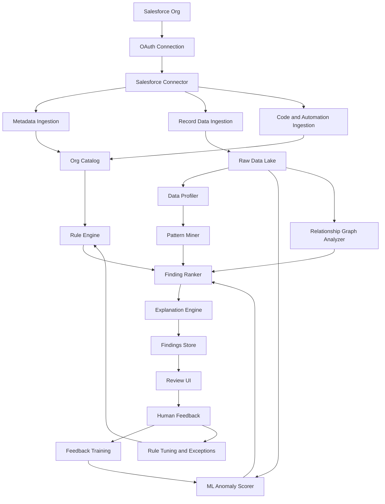

# System Architecture

## Architecture Summary

The platform should be built as a multi-tenant, metadata-aware, batch-first anomaly detection system.

At a high level:

```text
Salesforce Org
    |
    | OAuth + API Access
    v
Salesforce Connector
    |
    +--> Metadata Ingestion
    +--> Data Ingestion
    +--> Code/Automation Ingestion
    |
    v
Org Intelligence Layer
    |
    +--> Rule Engine
    +--> Data Profiler
    +--> Pattern Miner
    +--> Graph Analyzer
    +--> ML Anomaly Scorer
    +--> LLM Explanation Assistant
    |
    v
Findings Store
    |
    v
Review UI / Salesforce App / API
    |
    v
Human Feedback Loop
```

## Mermaid Architecture



## Core Components

### 1. Salesforce Connector

Responsible for:

- OAuth authentication
- API version management
- REST API calls
- Bulk API 2.0 jobs
- Metadata API retrieval
- Tooling API queries
- Rate limit handling
- Retry/backoff behavior
- Incremental extraction windows

### 2. Metadata Ingestion

Extracts:

- Objects
- Fields
- Field types
- Required flags
- Picklist values
- Record types
- Child relationships
- Validation rules
- Compact/layout metadata when useful
- Custom metadata types and records
- Custom settings
- Labels

### 3. Data Ingestion

Extracts records object by object.

For MVP:

- Account
- Contact
- Opportunity
- Case
- Selected custom objects

For enterprise:

- Configurable object selection
- Incremental sync using `SystemModstamp` or equivalent fields
- Bulk query partitioning
- Deleted/archived record handling where needed

### 4. Code And Automation Ingestion

Extracts:

- Apex classes
- Apex triggers
- Flow definitions
- Validation rule formulas
- Formula fields
- Workflow/process metadata where available

The first version should extract references rather than fully execute logic.

Example:

```text
Flow: Renewal Contract Creation
References:
- Opportunity.StageName
- Opportunity.Contract__c
- Account.Type
- Subscription__c.Renewal_Date__c
```

### 5. Org Catalog

The internal representation of one Salesforce org.

Stores:

- Object catalog
- Field catalog
- Relationship map
- Rule catalog
- Automation references
- Code references
- Business process graph
- Supported scan configuration

### 6. Rule Engine

Executes deterministic checks:

- Required field checks
- Picklist validity
- Lookup integrity
- Record type specific constraints
- Validation rule-derived checks
- Flow/code dependency warnings
- Custom metadata-driven checks

### 7. Data Profiler

Computes baseline statistics:

- Null rates
- Distinct counts
- Value frequencies
- Numeric/date distributions
- Field co-occurrence
- Relationship counts
- Status lifecycle timing
- Cohort-specific behavior

### 8. Pattern Miner

Learns implicit business expectations:

- Frequent field combinations
- Association rules
- Conditional expectations
- Object-specific patterns
- Record-type-specific patterns

### 9. Graph Analyzer

Analyzes relationship structures:

- Missing expected children
- Orphan records
- Suspicious relationship counts
- Broken business process chains
- Account/opportunity/contact/contract networks

### 10. ML Anomaly Scorer

Scores records using:

- Isolation Forest
- Local Outlier Factor
- Clustering distance
- Association rule violations
- Feedback-trained classifiers after enough review data exists

### 11. Explanation Engine

Combines evidence into user-facing explanations.

Evidence sources:

- Metadata rule
- Learned pattern
- Similar-record comparison
- Graph relationship issue
- ML anomaly score
- Flow/Apex field reference
- Prior reviewer feedback

### 12. Review UI

Allows users to:

- View findings
- Filter by object, severity, confidence, rule source
- Mark as real issue, false positive, valid exception, or needs review
- Add comments
- Export cleanup backlog
- Push selected findings into Salesforce as tasks/cases/custom records

## Deployment Modes

### MVP Mode

```text
Python jobs
PostgreSQL or DuckDB
Local/hosted web UI
Scheduled batch scans
```

### SaaS Mode

```text
Multi-tenant API backend
Worker queue
Object storage for raw data
PostgreSQL for metadata and findings
Warehouse/lakehouse for analytics
MLflow for model tracking
Tenant-isolated encryption
```

### Enterprise Private Mode

```text
Customer VPC deployment
Private object storage
Private warehouse
No cross-tenant data movement
Optional bring-your-own-key encryption
```

## Key Design Decision

Do not build this as a real-time first product.

Start batch-first:

- Nightly scans
- Weekly deep scans
- Incremental daily syncs
- On-demand targeted scans

Real-time checks can come later for selected high-value objects.

